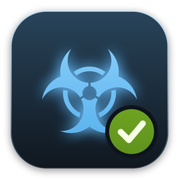
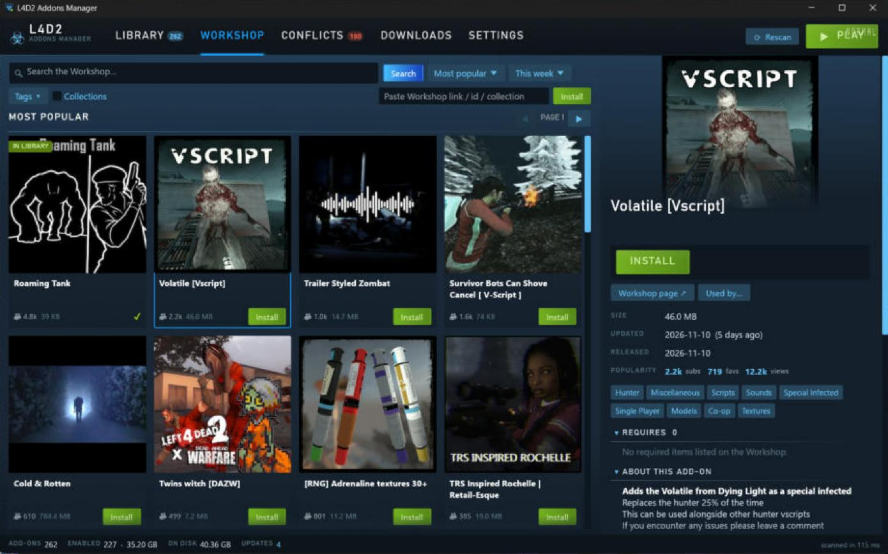

<p align="center">
  
</p>

<h1 align="center">L4D2 Addons Manager</h1>

<p align="center">
  A fast desktop add-on manager and Workshop browser for <b>Left 4 Dead 2</b>.<br>
  Fuzzy search, real filters, conflict detection, update checks and one-click Workshop installs: everything the in-game Add-ons menu is missing.
</p>

<p align="center">
  <a href="https://github.com/faustojc/l4d2-addons-app/releases/latest"><b>Download</b></a> ·
  <a href="#features">Features</a> ·
  <a href="#install">Install</a> ·
  <a href="#build-from-source">Build</a> ·
  <a href="#faq">FAQ</a>
</p>



## Why

The in-game Add-ons menu can't be changed by an add-on; its logic is hard-coded in `bin/gameui.dll`. So this app runs **beside** the game and edits the same files the game reads:

- `left4dead2/addons/*.vpk`
- `left4dead2/addonlist.txt`

It's a native Rust + egui app: one small executable, starts instantly, scans hundreds of add-ons in well under a second.

## Features

### Library
- **Fuzzy search** (multi-word, typo-tolerant, highlighted) across title, author, tags, file name / Workshop id and your own notes.
- **Filters:** enabled / disabled, conflicting, update available, missing requirements, locally patched, removed from the Workshop, not from the Workshop, installed twice, has notes. Category chips come from Workshop tags and `addoninfo.txt`.
- **Sort** by name, size, Workshop update date, file date, conflicts or popularity.
- **Bulk actions:** multi-select (Ctrl/Shift-click, Ctrl+A), then enable, disable, update or delete. Double-click toggles; right-click opens a menu.
- **Profiles:** save and apply sets of enabled add-ons, export/import them as JSON. Importing installs any missing Workshop items.
- **Notes:** a personal, searchable note per add-on.
- **Safe by default:** deletes go to the Recycle Bin / Trash, and `addonlist.txt` is backed up before the first change of each session. If the game is running, changes wait until it exits, because the game rewrites `addonlist.txt` on exit.

### Preview panel
- The **Workshop description** (Steam BBCode rendered: headings, lists, images, links, quotes, tables, spoilers), not the bare `addoninfo.txt`.
- The author's **screenshot gallery**, as on the Workshop page: click a thumbnail (or the main image) to view it enlarged, ◀ ▶ / arrow keys to page, Esc to close.
- Size, dates, subscribers, favorites, views, tags and creators.
- **Requires:** required Workshop items with their installed/enabled state and one-click Install / Enable.
- **Required by:** installed add-ons that depend on this one. **Used by…** lists every Workshop item that requires it.
- **Conflicts:** other add-ons shipping the same files, grouped by type, with overrides of stock game files marked.
- Full file list as a collapsible folder tree.

### Workshop browser
- Search, sort (popular this week/month/…, recent, updated, top rated, most subscribed), tag filter, collections and paging.
- Installs **straight into `addons/`** (or `addons/workshop/`, your choice). Required items install automatically.
- Parallel downloads with progress, speed, cancel and retry.
- Paste a Workshop link, id or collection link to install it.

### Conflicts
Every pair of add-ons replacing the same path with **different** contents. Identical copies and merged `*_addon.nut` / `addoninfo` files are ignored. Map add-ons only clash with another copy of the same map: different campaigns sharing assets never load together, and a skin or script overriding a map's file is the intended override. Pairs are ranked by how many stock game files they replace.

### Updates
Compares each item's Workshop `time_updated` with what the app installed (or the file date for add-ons it didn't install). **Update all** replaces files in place. Add-ons whose size differs from the Workshop file are flagged as *patched*, so a locally edited VPK isn't mistaken for an outdated one.

## Install

Grab the file for your system from the [latest release](https://github.com/faustojc/l4d2-addons-app/releases/latest).

| System | File | Notes |
|---|---|---|
| **Windows 10/11 (x64)** | `L4D2-Addons-Manager-<version>-windows-x64-setup.exe` | Installer with Start menu entry and uninstaller. Installs per-user by default, no admin needed. |
| | `…-windows-x64-portable.zip` | Single `.exe`, no install. |
| **Linux x64: Debian / Ubuntu / Mint / Pop!_OS** | `l4d2-addons-manager_<version>_amd64.deb` | `sudo apt install ./l4d2-addons-manager_*.deb` |
| **Linux x64: any distro, SteamOS / Steam Deck** | `…-linux-x64.tar.gz` | Extract, then run `./install.sh` (installs to `~/.local`, no root). `./install.sh --uninstall` removes it. |
| **macOS 11+ (Apple Silicon and Intel)** | `…-macos-universal.dmg` | Drag the app to Applications. See the macOS note below. |

**Windows SmartScreen:** the installer isn't code-signed, so Windows may show "Windows protected your PC". Click **More info → Run anyway**.

**macOS:** the app isn't notarized. On first launch, right-click the app and choose **Open**, or run `xattr -dr com.apple.quarantine "/Applications/L4D2 Addons Manager.app"`. Valve no longer ships a working macOS build of L4D2, so on a Mac this is mostly useful for managing a game folder you copied over or a CrossOver/Whisky install. Point it at that folder in **Settings**.

### First run
The app finds the game next to its own executable or through Steam's library folders (Windows registry; on Linux `~/.local/share/Steam`, `~/.steam/steam`, Flatpak and Snap Steam). If it can't, pick the **Left 4 Dead 2** install folder in **Settings**.

### Optional: Steam Web API key
Not required. Item details and downloads use public Steam endpoints. Requirement lists, though, come from Workshop pages, which Steam rate-limits, so the app fetches one page every few seconds and caches results for 3 days. With a free [Steam Web API key](https://steamcommunity.com/dev/apikey) (enter `localhost` as the domain), the app fetches all requirements in a few calls. Paste the key in **Settings**; it's stored only on your computer.

## Where data lives

| | Settings, profiles, notes, cache |
|---|---|
| Windows | `%APPDATA%\L4D2AddonManager\` |
| Linux | `~/.config/L4D2AddonManager/` |
| macOS | `~/Library/Application Support/L4D2AddonManager/` |

## Build from source

Needs [Rust](https://rustup.rs) 1.85+ (edition 2024).

```bash
cargo build --release
```

The binary is `target/release/l4d2-addons-manager` (`.exe` on Windows). Run `cargo test` for the unit tests. A debug build run with `--check` does a headless self-test against your real install and Steam.

On Linux you may need `libxkbcommon-dev libwayland-dev libgl1-mesa-dev` (Debian/Ubuntu names).

### Packaging

Installers are built by GitHub Actions ([`.github/workflows/release.yml`](.github/workflows/release.yml)) on every push. Pushing a tag publishes a release:

```bash
git tag v0.1.0
```

```bash
git push origin v0.1.0
```

To build them by hand:

- **Windows:** install [Inno Setup 6](https://jrsoftware.org/isinfo.php), then run `iscc /DAppVersion=0.1.0 packaging\windows\installer.iss` after `cargo build --release`.
- **Linux:** run `cargo install cargo-deb`, then `cargo deb`. The tarball layout is in the workflow.
- **macOS:** run `sh packaging/macos/bundle.sh 0.1.0` (needs both `aarch64-apple-darwin` and `x86_64-apple-darwin` targets).

The icon is generated by `python packaging/make_icon.py` (needs Pillow) and written to `assets/`.

## FAQ

**Will this get me VAC banned?**
No. It only moves `.vpk` files and edits `addonlist.txt`, exactly what the in-game menu and Steam do. It never touches the running game.

**Why do I see an add-on twice ("2×")?**
It's both in `addons/` (installed by this app) and `addons/workshop/` (a Steam subscription). Unsubscribe on Steam or delete one copy.

**Which add-on wins a conflict?**
That depends on the game's load order, which the game doesn't expose. Disable one side to be sure.

**Does Steam update add-ons installed into `addons/`?**
No. Those aren't subscriptions, so this app checks and updates them for you.

## License

[MIT](LICENSE). Not affiliated with or endorsed by Valve. Left 4 Dead, Steam and the Steam Workshop are trademarks of Valve Corporation.
